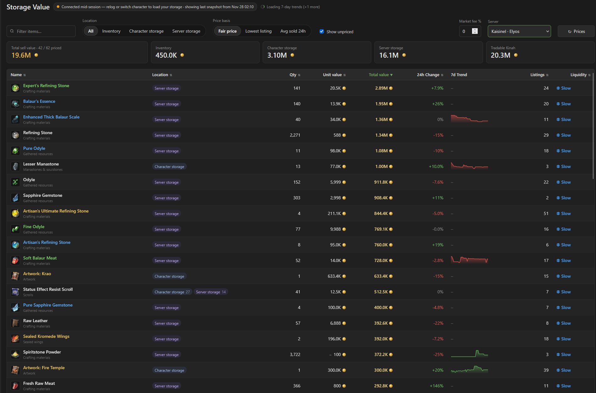

# AION 2 Vault

See what your inventory, character storage and server storage are worth on the market, sorted by value.

**[⬇ Download the latest release](https://github.com/ahmkhe/aion2-vault/releases/latest)**

## Install

1. Install **[Npcap](https://npcap.com/#download)**, the same capture driver DPS meters use. Keep the default options, and leave *"Restrict Npcap driver's access to Administrators only"* unticked.
2. Download `AION2Vault-vX.Y-win64.zip` from Releases, unzip it anywhere, and run **`AION2Vault.exe`**.
   - If Windows SmartScreen appears, click **More info → Run anyway**.

## Use

1. Open AION 2 Vault **before** logging in to your character. If you're already in game, go to character select and back.
2. Pick your **server and faction** at the top right.
3. Your items appear automatically. Open each storage in game once if it shows empty.
4. Hover over any item to see how its price was worked out.
5. Closing the window (X) keeps it running in the **system tray**, so it keeps tracking. Click the tray icon to reopen it, or right-click → **Quit** to exit.

**Price modes:**
- **Fair price** (default): the lowest of the current listing, the 7-day median and the 24h average sale price. If that's more than 2.5× the median on other servers in your region, the region median is used instead.
  - Items that aren't listed on your server now and haven't sold recently aren't priced or counted. They show their last listing in grey.
- **Lowest listing:** the cheapest current listing on your server.
- **Avg sold 24h:** the average sale price over the last 24 hours.

Set **Market fee %** to see what you'd actually receive after the market fee.

## Privacy & safety

- **Read-only:** it listens to the game's network traffic, like a DPS meter. It never sends anything to the game, never touches game files or memory, and never reads your login.
- **Only your own data:** it reads just your own items, keeps them on your PC (`%APPDATA%\AION2Vault`) and uploads nothing.
- **Open source:** the code is public under the MIT license, and every release is built from it on GitHub Actions, so you can check exactly what you run.
- **Not counted:** soul-bound gear and bound items can't be sold, so they're left out.
- **Outside services:**
  - Prices come from the public [aion2.exchange](https://aion2.exchange) API, fetched gently and cached. Your item IDs are mixed with random items, so a request doesn't reveal exactly what you own.
  - Item names and icons ship inside the app, so it doesn't contact NCSOFT for them. Only items newer than the release are looked up online.
  - About twice a day it asks GitHub for the latest release number, and shows a banner when a newer version is out. Nothing about you or your items is sent. Untick **check for updates** at the bottom right to turn it off.
- **Unofficial:** this is a third-party fan tool, not affiliated with NCSOFT. AION, item names and icons are © NCSOFT. Use it at your own risk.

## Troubleshooting

| Status | Fix |
|---|---|
| Npcap is required | Install Npcap, then press **Check again** |
| Npcap is set to administrators only | Press **Restart as administrator**, or reinstall Npcap with that option unticked |
| Connected mid-session | Relog, or switch character |
| Game not running | Start AION 2. The app looks for `AION2.exe` |
| Prices won't load, `CERTIFICATE_VERIFY_FAILED` | Update to v0.0.3 or newer. If it persists, check your PC's date and time, and any antivirus HTTPS scanning |
| Error about `Python.Runtime` on start (v0.0.1 only) | Update to the latest release. Or, before unzipping, right-click the zip → Properties → **Unblock** |
| Items missing or wrong amounts | Update to the latest release. If it persists, see *Reporting a problem* below |

The log is in `%APPDATA%\AION2Vault\vault.log`. Deleting that folder resets the app.

### Reporting a problem

1. Close AION 2 Vault (tray icon → Quit).
2. Start it with diagnostics on (v0.0.4 or newer). In PowerShell, from the folder you unzipped it to, run `.\AION2Vault.exe --diagnose`.
3. Log in to your character, then open an [issue](https://github.com/ahmkhe/aion2-vault/issues) and attach `%APPDATA%\AION2Vault\vault.log`.

The log has no account or character names. With `--diagnose`, a capture of your own inventory messages is also saved in `%APPDATA%\AION2Vault\diagnostics`. Only share it if you're asked to; it lists your items.

---

### Development

Run from source with Python 3.11+ and `pip install -r requirements.txt`, then `python app.py`.
- `--browser` opens it in a browser tab instead of a window.
- `--demo` shows sample data without capturing.
- `--diagnose` logs capture details and saves inventory messages to `data\diagnostics`. Read a capture with `python tools\analyze_capture.py <file> --find "Item name"`.
- `python test_protocol.py` runs the decoder test.

When running from source, everything is kept in `data\`, which git ignores.

### Building and releasing

- **Every push and pull request to `main`:** GitHub Actions runs the decoder test and builds the exe. The zip is attached to the run for testing, and nothing is released.
- **To publish a release:**
  1. Set `VERSION` in `prices.py`, e.g. `"0.0.4"`.
  2. Write `release/notes-v0.0.4.md`.
  3. Commit, then `git tag v0.0.4` and `git push origin v0.0.4`.

  The release workflow checks that the tag matches `VERSION`, builds the exe, and publishes the zip and its `.sha256` with your notes. Installed copies (v0.0.4+) see it as an update within 12 hours.
- **Building locally:** `.\build.ps1` writes `release\AION2Vault-v<version>-win64.zip`. Add `-SkipItemDb` to use the committed item data, which is what CI does.
- **Item database** (`web/itemdb.json`, `web/icons/`):
  - `python tools\build_itemdb.py` adds names and 64 px icons for new market items from NCSOFT. Items NCSOFT doesn't list get their icon from aion2.exchange.
  - `--fill-missing` only fills in missing icons; `--full` rebuilds everything.
  - Commit the result. Pillow is used at build time only and isn't shipped.

Third-party licenses are listed in `THIRD-PARTY-NOTICES.txt` inside the release.

### License

[MIT](LICENSE) for the code. AION, item names and item icons belong to NCSOFT.
